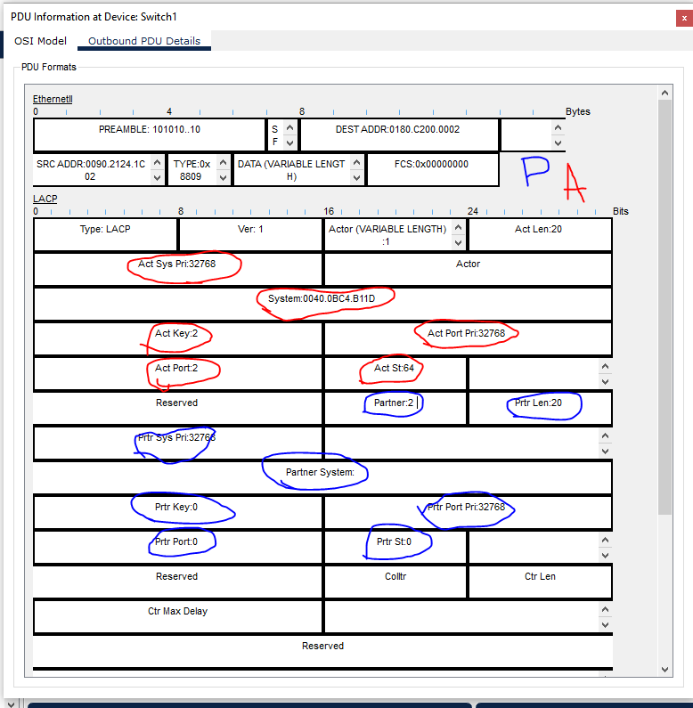

# Отчет по лабораторной работе №N5
**Тема:** LAG
**Выполнил:** Малородная А.Е., Мекшеева А.А., Краковцев В.А., гр. 439

## Топология


## Ответы на вопросы
1. Потому что некоторые интерфейсы могут находиться в состоянии Down, т.к. физическое соединение ещё не активировано, интерфейсы отключены или протоколы агрегации ещё не настроены.
2. Агрегированный канал: в состоянии (SU) — логически включен. Дочерние интерфейсы: в состоянии (D) — физически отключены. Интерфейсы на маршрутизаторе по умолчанию находятся в состоянии shutdown. Нет, не готов. Несмотря на то, что логический интерфейс Po1 показывает статус Up, физический уровень не работает. Пакеты отправляться не будут, так как физические интерфейсы не пропускают сигнал. Да, это может вызвать проблемы и привести к потере пакетов и отсутсвию связи.
```text
show etherchannel summary
Flags:  D - down        P - in port-channel
        I - stand-alone s - suspended
        H - Hot-standby (LACP only)
        R - Layer3      S - Layer2
        U - in use      f - failed to allocate aggregator
        u - unsuitable for bundling
        w - waiting to be aggregated
        d - default port


Number of channel-groups in use: 1
Number of aggregators:           1

Group  Port-channel  Protocol    Ports
------+-------------+-----------+----------------------------------------------

1      Po1(SU)           -      Gig0/1(D) Gig0/2(D) 
```
```text
show etherchannel port-channel
                Channel-group listing:
                ----------------------

Group: 1
----------
                Port-channels in the group:
                ---------------------------

Port-channel: Po1
------------

Age of the Port-channel   = 00d:00h:19m:14s
Logical slot/port   = 2/1       Number of ports = 2
GC                  = 0x00000000      HotStandBy port = null
Port state          = Port-channel 
Protocol            =   PAGP
Port Security       = Disabled

Ports in the Port-channel:

Index   Load   Port     EC state        No of bits
------+------+------+------------------+-----------
  0     00     Gig0/1   On                 0
  0     00     Gig0/2   On                 0
Time since last port bundled:    00d:00h:11m:35s    Gig0/2
```
```text
show interfaces Po1
Port-channel1 is up, line protocol is up (connected)
  Hardware is EtherChannel, address is 000c.8593.adcc (bia 000c.8593.adcc)
  MTU 1500 bytes, BW 2000000 Kbit, DLY 1000 usec,
     reliability 255/255, txload 1/255, rxload 1/255
  Encapsulation ARPA, loopback not set
  Keepalive set (10 sec)
  Half-duplex, 2000Mb/s
  input flow-control is off, output flow-control is off
  Members in this channel: 
  ARP type: ARPA, ARP Timeout 04:00:00
  Last input 00:00:08, output 00:00:05, output hang never
  Last clearing of "show interface" counters never
  Input queue: 0/75/0/0 (size/max/drops/flushes); Total output drops: 0
  Queueing strategy: fifo
  Output queue :0/40 (size/max)
  5 minute input rate 0 bits/sec, 0 packets/sec
  5 minute output rate 0 bits/sec, 0 packets/sec
     956 packets input, 193351 bytes, 0 no buffer
     Received 956 broadcasts, 0 runts, 0 giants, 0 throttles
     0 input errors, 0 CRC, 0 frame, 0 overrun, 0 ignored, 0 abort
     0 watchdog, 0 multicast, 0 pause input
     0 input packets with dribble condition detected
     2357 packets output, 263570 bytes, 0 underruns
     0 output errors, 0 collisions, 10 interface resets
     0 babbles, 0 late collision, 0 deferred
     0 lost carrier, 0 no carrier
     0 output buffer failures, 0 output buffers swapped out
```

3. Так как вторая сторона еще не настроена, канал находиться в состоянии down (SD). Физические интерфейсы в состоянии (I). Трафик он пока не передает.
```text
show etherchannel summary
Flags:  D - down        P - in port-channel
        I - stand-alone s - suspended
        H - Hot-standby (LACP only)
        R - Layer3      S - Layer2
        U - in use      f - failed to allocate aggregator
        u - unsuitable for bundling
        w - waiting to be aggregated
        d - default port


Number of channel-groups in use: 2
Number of aggregators:           2

Group  Port-channel  Protocol    Ports
------+-------------+-----------+----------------------------------------------

1      Po1(SU)           -      Gig0/1(P) Gig0/2(P) 
2      Po2(SD)           LACP   Fa0/1(I) Fa0/2(I)
```
```text
show etherchannel port-channel
                Channel-group listing:
                ----------------------

Group: 1
----------
                Port-channels in the group:
                ---------------------------

Port-channel: Po1
------------

Age of the Port-channel   = 00d:00h:53m:26s
Logical slot/port   = 2/1       Number of ports = 2
GC                  = 0x00000000      HotStandBy port = null
Port state          = Port-channel 
Protocol            =   PAGP
Port Security       = Disabled

Ports in the Port-channel:

Index   Load   Port     EC state        No of bits
------+------+------+------------------+-----------
  0     00     Gig0/1   On                 0
  0     00     Gig0/2   On                 0
Time since last port bundled:    00d:00h:45m:47s    Gig0/2
Group: 2
----------
                Port-channels in the group:
```
```text
show interfaces Po2
Port-channel2 is down, line protocol is down (disabled)
  Hardware is EtherChannel, address is 000b.be13.b3cd (bia 000b.be13.b3cd)
  MTU 1500 bytes, BW 200000 Kbit, DLY 1000 usec,
     reliability 255/255, txload 1/255, rxload 1/255
  Encapsulation ARPA, loopback not set
  Keepalive set (10 sec)
  Half-duplex, 200Mb/s
  input flow-control is off, output flow-control is off
  Members in this channel: Fa0/1 ,Fa0/2 ,
  ARP type: ARPA, ARP Timeout 04:00:00
  Last input 00:00:08, output 00:00:05, output hang never
  Last clearing of "show interface" counters never
  Input queue: 0/75/0/0 (size/max/drops/flushes); Total output drops: 0
  Queueing strategy: fifo
  Output queue :0/40 (size/max)
  5 minute input rate 0 bits/sec, 0 packets/sec
  5 minute output rate 0 bits/sec, 0 packets/sec
     956 packets input, 193351 bytes, 0 no buffer
     Received 956 broadcasts, 0 runts, 0 giants, 0 throttles
     0 input errors, 0 CRC, 0 frame, 0 overrun, 0 ignored, 0 abort
     0 watchdog, 0 multicast, 0 pause input
     0 input packets with dribble condition detected
     2357 packets output, 263570 bytes, 0 underruns
     0 output errors, 0 collisions, 10 interface resets
     0 babbles, 0 late collision, 0 deferred
     0 lost carrier, 0 no carrier
     0 output buffer failures, 0 output buffers swapped out
```

4. Это исходящий пакет от Switch1. Он только отправил запрос, но еще не получил ответный пакет от Switch2, поэтому пока не знает данных партнера.
!

5. Нет, различие номеров не мешает. Номер группы EtherChannel является локальным параметром каждого коммутатора. Поэтому SW1 может использовать группу 2, а SW2 - группу 1.
```text
show etherchannel port-channel
                Channel-group listing:
                ----------------------

Group: 1
----------
                Port-channels in the group:
                ---------------------------

Port-channel: Po1    (Primary Aggregator)
------------

Age of the Port-channel   = 00d:00h:01m:01s
Logical slot/port   = 2/1       Number of ports = 2
GC                  = 0x00000000      HotStandBy port = null
Port state          = Port-channel 
Protocol            =   LACP
Port Security       = Disabled

Ports in the Port-channel:

Index   Load   Port     EC state        No of bits
------+------+------+------------------+-----------
  0     00     Fa0/1    Passive            0
  0     00     Fa0/2    Passive            0
Time since last port bundled:    00d:00h:00m:51s    Fa0/2
```

6. 
```text
show etherchannel summary
Flags:  D - down        P - in port-channel
        I - stand-alone s - suspended
        H - Hot-standby (LACP only)
        R - Layer3      S - Layer2
        U - in use      f - failed to allocate aggregator
        u - unsuitable for bundling
        w - waiting to be aggregated
        d - default port


Number of channel-groups in use: 3
Number of aggregators:           3

Group  Port-channel  Protocol    Ports
------+-------------+-----------+----------------------------------------------

1      Po1(SU)           -      Gig0/1(P) Gig0/2(P) 
2      Po2(SU)           LACP   Fa0/1(P) Fa0/2(P) 
3      Po3(SU)           PAgP   Fa0/3(P) Fa0/4(P) 
```
```text
show etherchannel port-channel
                Channel-group listing:
                ----------------------

Group: 1
----------
                Port-channels in the group:
                ---------------------------

Port-channel: Po1
------------

Age of the Port-channel   = 00d:01h:23m:56s
Logical slot/port   = 2/1       Number of ports = 2
GC                  = 0x00000000      HotStandBy port = null
Port state          = Port-channel 
Protocol            =   PAGP
Port Security       = Disabled

Ports in the Port-channel:

Index   Load   Port     EC state        No of bits
------+------+------+------------------+-----------
  0     00     Gig0/1   On                 0
  0     00     Gig0/2   On                 0
Time since last port bundled:    00d:01h:16m:17s    Gig0/2
Group: 2
----------
                Port-channels in the group:
                ---------------------------

Port-channel: Po2    (Primary Aggregator)
------------

Age of the Port-channel   = 00d:00h:31m:56s
Logical slot/port   = 2/2       Number of ports = 2
GC                  = 0x00000000      HotStandBy port = null
Port state          = Port-channel 
Protocol            =   LACP
Port Security       = Disabled

Ports in the Port-channel:

Index   Load   Port     EC state        No of bits
------+------+------+------------------+-----------
  0     00     Fa0/1    Active             0
  0     00     Fa0/2    Active             0
Time since last port bundled:    00d:00h:06m:30s    Fa0/2
Group: 3
----------
                Port-channels in the group:
                ---------------------------

Port-channel: Po3
------------

Age of the Port-channel   = 00d:00h:02m:47s
Logical slot/port   = 2/3       Number of ports = 2
GC                  = 0x00000000      HotStandBy port = null
Port state          = Port-channel 
Protocol            =   PAGP
Port Security       = Disabled

Ports in the Port-channel:

Index   Load   Port     EC state        No of bits
------+------+------+------------------+-----------
  0     00     Fa0/3    Desirable-Sl       0
  0     00     Fa0/4    Desirable-Sl       0
Time since last port bundled:    00d:00h:01m:20s    Fa0/4
```

7. 
```text
interface Port-channel2
!
interface FastEthernet0/1
 channel-group 2 mode active
!
interface FastEthernet0/2
 channel-group 2 mode active
```
8. В предыдущей конфигурации Port-channel 2 использовался как агрегированный канал без дополнительных параметров магистрального интерфейса. После настройки он работает в режиме trunk, автоматическое согласование DTP отключено, а функция PortFast включена.
```text
interface Port-channel2
 switchport mode trunk
 switchport nonegotiate
 spanning-tree portfast trunk
!
interface FastEthernet0/1
 switchport mode trunk
 switchport nonegotiate
 channel-group 2 mode active
!
interface FastEthernet0/2
 switchport mode trunk
 switchport nonegotiate
 channel-group 2 mode active
```
9. Текущий способ вычисления - Source MAC address. Если большая часть трафика идет в направлении R1, то у всего этого трафика будет один и тот же MAC-адрес назначения (MAC-адрес R1).
10. Мы выбрали алгоритм src-dst-ip, поскольку он учитывает IP-адреса источника и назначения пакетов. Это позволяет лучше распределять потоки данных между физическими интерфейсами, особенно если в сети передаётся большое количество трафика от разных устройств.